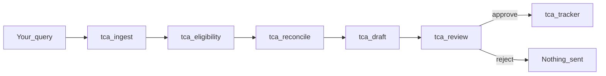

# Training Coordinator (ADK mock)

Camping World / Good Sam **Field Onboarding** assistant for **GM**, **FOD**, and **OEM Parts**.

The agent reads mock hire exports, applies `governance.md`, reconciles `trainings.md` against a fake calendar, drafts mail/invites (never sends), waits for a human, then **recommends** Excel cells (never writes SharePoint).

## Shareable UI (Cloud Run)

https://tca-adk-demo-741027775203.us-central1.run.app/dev-ui/

1. Open the link.
2. Select **training_coordinator**.
3. Send `hi` for the welcome (rules: mock tools only, do not invent employees, follow governance.md).
4. Paste query 1 below. The agents already enforce those rules even if you omit them.
5. When review stops, type `approve` or `reject`.

The service stays warm (`min-instances=1`, 2 CPU). A full weekly packet still takes a few OpenRouter steps; `hi` should return immediately.

OpenRouter key lives in Secret Manager (`tca-openrouter-api-key`), not in git.

## Query 1 — full weekly flow

**Paste**

```text
What's due for GM and OEM Parts the week of 2026-09-21? Use mock tools only. Do not invent employees. Follow governance.md.
```

### What you should see

| Step | Agent | Tools | Result |
|---|---|---|---|
| 1 | `tca_ingest` | `sharepoint_workday_export_reader` | Hires only: E-088, E-100, E-141 (OEM), E-204 (GM), E-310 (FOD). No enroll. |
| 2 | `tca_eligibility` | `lookup_governance_rules`, `compute_eligibility`, `sharepoint_roster_reader` | Event-based holds: GM → P14, FOD → P7, OEM → P1. E-088 mid-cycle → `hold_next_cycle` if cohort closed. |
| 3 | `tca_reconcile` | `lookup_trainings_plan`, `find_session_invite`, `resolve_session_stakeholders` | **GM-5** DMS & Financials Tue/Thu 11:00 CST. Plan facilitator **P20 Jesse Jensen**. Calendar **Spencer Toomey** (`s.toomey@…`) **wins**. **OEM-5** Parts Financials 2:30 CST (P8, P30, P31). **No FOD session** that week. |
| 4 | `tca_draft` | `whats_due_all`, `draft_email` / `draft_session_invite` | Drafts `pending_confirmation`, `sent: false`. |
| 5 | `tca_review` | none | Packet + **approve / reject**. Stops. |



### After you type `approve`

Only `tca_tracker` runs. It does **not** send mail or write Excel.

| Person | Tracker row | After approve |
|---|---|---|
| E-204 Diego | GM row 3, `pending_eligibility` | Do **not** mark committed. Still waiting on P14. |
| E-100 Morgan | OEM_Parts row 5, already 2 sessions | Often no status change. |
| E-141 Priya | OEM_Parts row 6, 1 session | Notes only if needed. |
| E-088 Casey | hold_next_cycle | Leave on hold. |

Every `recommend_tracker_edit` stays `wrote_sharepoint: false`.

`reject` skips the tracker and says nothing was sent.

## Traces

The Cloud Run ADK **Trace** tab is often empty: that host is `adk api_server --with_ui`, which does not serve `/dev/.../debug/trace`. Use these instead:

**1. Events in the ADK page**  
Same chat → Events. You should see tool names from the table above.

**2. Google Cloud Trace** (enabled on this deploy)

https://console.cloud.google.com/traces/list?project=ai-ml-team-sandbox

Filter service `tca-adk-demo` after you run query 1. Spans are LLM + tool calls.

**3. Local ADK traces** (full Dev UI Trace panel)

```bash
uv sync
cp .env.example .env   # set OPENROUTER_API_KEY
uv run adk web adk_agents --port 8080
```

Open http://127.0.0.1:8080, pick **training_coordinator**, run query 1, open **Trace**.

## Other test queries

| # | Query |
|---|---|
| 0 | `hi` |
| 2 | Read new GM and OEM Parts hires from /HR/WorkdayExports. Use sharepoint_workday_export_reader only. Flag each as awaiting inclusion. Do not enroll. |
| 3 | OEM Parts participant E-088 started 2026-07-01 and asked to join mid-cycle as of 2026-09-17. Use compute_eligibility with cohort_open false. Expect hold_next_cycle. Escalate to P1. Do not enroll. |
| 4 | Evaluate OEM hire E-001 started 2025-01-01 as of 2026-09-17. Use compute_eligibility. Expect ineligible above_maximum_tenure. |
| 5 | trainings.md lists P20 Jesse Jensen for GM-5 (DMS & Financial Management). Reconcile with the live invite. Calendar wins. Do not invent availability. |
| 6 | Is there a FOD session the week of 2026-09-21? If trainings.md has none, say so. Do not invent a session. |
| 7 | Draft the OEM-5 Parts Financials reminder and invite for 2026-09-22 2:30 PM CST. Approved-template tone. Do not send. |
| 8 | New GM E-204 appeared on the hire export. Event-based trigger. Hold for P14 Karen Lorden. Write an ESCALATION NOTICE. Do not add them to the tracker. |
| 9 | E-100 completed OEM session 2. Recommend the exact tracker cell. Do not write SharePoint. Use tab OEM_Parts. |
| 10 | After query 1: `approve` |
| 11 | After a draft query, new reply: `reject` |

## Local FastAPI (not the ADK demo)

```bash
uv sync
make dev
```

http://localhost:8000/api/v1/docs — scaffold API only, not the full tool graph.

## Redeploy Cloud Run

Needs `gcloud` on **ai-ml-team-sandbox** and Secret Manager secret `tca-openrouter-api-key`.

```bash
make adk-deploy
```

## Policy files

- [`domains/org/workflows/training-coordinator-agent/governance.md`](domains/org/workflows/training-coordinator-agent/governance.md)
- [`domains/org/workflows/training-coordinator-agent/trainings.md`](domains/org/workflows/training-coordinator-agent/trainings.md)
- Mock data: `domains/org/workflows/training-coordinator-agent/fixtures/`
