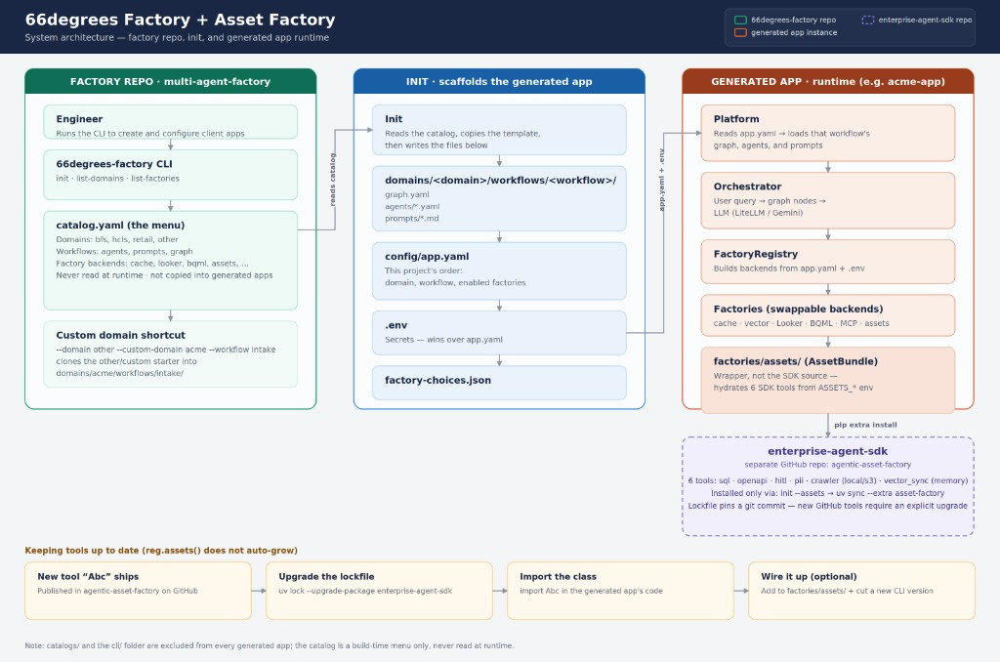

# Getting started

`66harness` generates **one project** per domain + workflow. The same package is the runtime template.



<div class="grid cards" markdown>

-   :material-download: [Install the CLI](guide/install.md)

    ---

    Checkout, `uv tool`, Artifact Registry, or a local wheel.

-   :material-console: [CLI reference](guide/cli.md)

    ---

    Every subcommand and `init` flag.

-   :material-file-tree: [Catalog layout](guide/catalog.md)

    ---

    Domain shards and `factories.yaml` (merged at load).

-   :material-folder-plus: [Init a project](guide/init.md)

    ---

    What is copied, written, and refused.

-   :material-map-marker: [GSSE (retail)](guide/gsse.md)

    ---

    Geospatial site suitability, Asset Factory tools, gemini-enterprise.

-   :material-cash-refund: [Dispute handler (retail)](guide/dispute-handler.md)

    ---

    Autonomous disputes/returns, HITL review, OPA settle bundle.

-   :material-puzzle: [Factories](guide/factories.md)

    ---

    Env keys, extras, Looker / BQML / Asset Factory.

-   :material-play-circle: [Run the app](guide/run.md)

    ---

    HTTP surface, make targets, smoke scripts.

-   :material-cloud: [Publish & host](guide/publish-gcp.md)

    ---

    Artifact Registry package. Cloud Run docs site.

-   :material-shield-check: [OPA Governance](governance/opa-rules.md)

    ---

    Path tiers, contribution rules, and policy validation.

</div>

## Contract

| Rule | Meaning |
|------|---------|
| One `init` | One domain, one workflow, one output directory |
| Full snapshot | Entire template copy. Unused factory folders stay on disk |
| Runtime swap | Backends from `config/app.yaml` then env. `init` writes `app.yaml` + `.env` |
| Index URL | Must end in `/simple/` |
| Ports | Docs local `:8001`. FastAPI `:8000` |

!!! warning "Do not init into the template"
    Output must be a **new** directory (for example `~/Desktop/demo-afi`). `init` refuses the source tree.

## Local preview

```bash
cd /Users/ritesh/Desktop/multi-agent-factory
make docs
```

Open [http://127.0.0.1:8001](http://127.0.0.1:8001).
